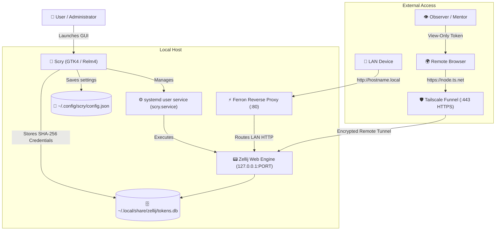

# Scry

<p align="center">
  
</p>

<p align="center">
  <strong>Fast, secure, persistent web terminal GUI for LAN and global Tailscale Funnel access.</strong>
</p>

<p align="center">
  
  
  
  
  
  
</p>

---

## 🌟 Overview

**Scry** is a modern, native GTK4/Libadwaita desktop application built in Rust designed for **Lilith Linux** (and compatible modern Linux distributions). It empowers users of any technical skill level to spin up, manage, and share persistent web terminal environments.

Whether you need quick terminal access across your local living room Wi-Fi, full remote control over the public internet from your smartphone or tablet, or a view-only stream to collaborate with a colleague, Scry automates the entire networking, credential hashing, and system service orchestration behind an intuitive, dark-themed interface.

---

## ✨ Features

- **🖥️ Persistent Terminal Environments**
  - Powered under the hood by [Zellij](https://zellij.dev).
  - Shell sessions continue running even when browsers disconnect, windows close, or systems reboot.
- **🌐 Dual-Mode Network Exposure**
  - **Local LAN Mode**: Instant discovery on your home or office network via mDNS (`http://<hostname>.local/`).
  - **Serve to Web (Tailscale Funnel)**: Secure, encrypted end-to-end HTTPS routing accessible from any browser anywhere in the world (`https://<node>.ts.net/`).
- **🔒 Password & PIN Security**
  - Replaces fragile, cryptic temporary tokens with memorable user passwords or PINs.
  - Passwords are salted and stored via SHA-256 in Zellij's authentication SQLite database.
- **👁️ Observer / View-Only Mode**
  - Generate secondary, real-time read-only access codes.
  - Allows mentors, friends, or colleagues to watch your live terminal session in real time without allowing them to type or execute commands.
- **📱 Instant Mobile QR Codes**
  - Displays instant, high-contrast QR codes directly on your screen.
  - Scan with any smartphone camera to immediately open your terminal or share observer links.
- **🎛️ Multi-Session Manager**
  - Integrated GNOME Libadwaita `ViewSwitcher` tabs to navigate between **Terminal** controls and **Sessions**.
  - Monitor all running background sessions, wake/resurrect exited sessions, put terminals to sleep, or delete unwanted sessions.
- **⚙️ Custom Port Selector**
  - Built-in spin selector to configure custom network ports (defaulting to port `8082`).
- **🔄 System Persistence & Auto-Boot**
  - Integrates with systemd user services (`scry.service`).
  - Enables user lingering (`loginctl enable-linger`) so your terminal stays alive through lid closures, logouts, and system reboots.
- **🧼 Fresh Reset (Test from Scratch)**
  - Single-click toolbar button (`edit-clear-symbolic`) to wipe all configured states, tokens, systemd units, and restore fresh distro-level defaults.

---

## 🏗️ Architecture



---

## 🚀 Installation & Building

### Prerequisites

Scry is designed for **Ubuntu 24.04+**, **Lilith Linux**, and Debian-based systems with GTK4 and Libadwaita installed:

```bash
# Install core system dependencies
sudo apt update
sudo apt install -y \
    build-essential \
    pkg-config \
    libgtk-4-dev \
    libadwaita-1-dev \
    sqlite3 \
    libsqlite3-dev \
    curl \
    git
```

Ensure Rust and Zellij are installed:
```bash
# Rust Toolchain
curl --proto '=https' --tlsv1.2 -sSf https://sh.rustup.rs | sh
source "$HOME/.cargo/env"

# Zellij Terminal Workspace
cargo install zellij
```

*(Optional for Web Exposure)* Install [Tailscale](https://tailscale.com):
```bash
curl -fsSL https://tailscale.com/install.sh | sh
sudo tailscale up
```

---

### Build and Install Scry

Clone and run the automated installation script:

```bash
git clone https://github.com/<your-username>/Scry.git ~/Scry
cd ~/Scry
./install.sh
```

The script compiles an optimized release build and automatically installs:
- **Binary**: `/usr/local/bin/scry` (with symlinks `/usr/local/bin/Scry` and `/usr/local/bin/lilith-web-terminal`)
- **Desktop Entry**: `/usr/share/applications/org.lilith.Scry.desktop`
- **Icon**: `/usr/share/icons/hicolor/scalable/apps/org.lilith.Scry.svg`

---

## 💡 Usage

### Launching

Launch Scry from your application launcher or directly via terminal:
```bash
scry
```

### Quick Walkthrough

1. **Local Access (Default)**:
   - Keep "Serve to Web" turned **Off**.
   - Check "Password Protection" and enter your chosen password.
   - Click **Create Web Terminal**.
   - Once online, open `http://<your-hostname>.local/` or scan the QR code with your phone.

2. **Remote Web Access**:
   - Toggle **Serve to Web** to **On**.
   - If not already logged into Tailscale, click **Connect Tailscale**.
   - Enter your password and click **Create Web Terminal**.
   - Access your terminal from anywhere in the world using your Tailscale Funnel URL.

3. **Observer View-Only Link**:
   - In either the **Terminal** tab or the **Sessions** tab, find your session.
   - Click **Generate Link** under *Observer / View-Only Access*.
   - A unique observer passcode is generated.
   - Share the URL and observer passcode with your viewer, or display the Observer QR code!

4. **Multi-Session Management**:
   - Click the **Sessions** tab in the top header.
   - View all existing sessions on your host.
   - Wake exited sessions, put active terminals to sleep, or delete finished sessions.

---

## 📁 Configuration & Paths

| Item | Path | Purpose |
|------|------|---------|
| **Application Config** | `~/.config/scry/config.json` | Stores GUI toggles, session names, and port settings |
| **Systemd Unit** | `~/.config/systemd/user/scry.service` | User systemd unit managing the background web server |
| **Credentials Database**| `~/.local/share/zellij/tokens.db` | SQLite database holding SHA-256 hashed passwords & tokens |
| **Desktop Launcher** | `/usr/share/applications/org.lilith.Scry.desktop` | Standard XDG desktop entry |
| **Application Icon** | `/usr/share/icons/hicolor/scalable/apps/org.lilith.Scry.svg` | Vector application icon |

---

## 👥 Contributing & Distro Integration

Scry is developed as a native feature for **Lilith Linux**. Contributions, issue reports, and pull requests are warmly welcome!

1. Fork the Project
2. Create your Feature Branch (`git checkout -b feature/AmazingFeature`)
3. Commit your Changes (`git commit -m 'Add some AmazingFeature'`)
4. Push to the Branch (`git push origin feature/AmazingFeature`)
5. Open a Pull Request

---

## 📄 License

Distributed under the MIT License. See `LICENSE` for more information.
